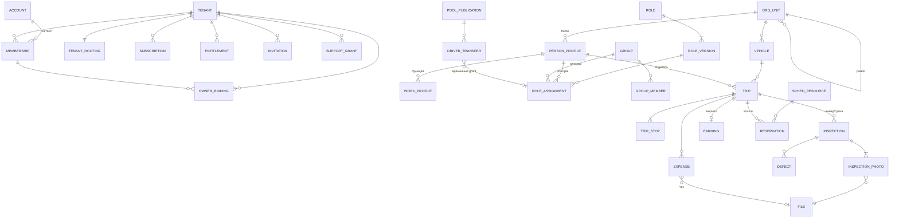

# 10. Модель данных — версия 0.2

Черновик от 1 октября 2026 года для этапов S1 «Основа» и S2 «Рабочая логистика». DDL: `db/control_0001_init.sql`, `db/tenant_0001_core.sql`, `db/tenant_0002_fleet.sql`. Документ дополняет `02-architecture.md` и не меняет его решений. Модель SPA, склада, кассы и ремонта появится в 0003+ после расширения OpenAPI.

## СУБД

PostgreSQL ≥ 13 (используются `gen_random_uuid()`, `tstzrange`, `EXCLUDE USING gist`, частичные индексы). Нужно расширение `btree_gist` из contrib; в управляемых PostgreSQL его наличие проверить у провайдера (D-05).

**Проверка 01.10.2026.** Все три миграции применены без ошибок на PostgreSQL 16.4: 36 таблиц в 11 схемах tenant DB плюс control DB. Проверены ограничения:

| Сценарий | Результат |
|---|---|
| Пересекающаяся бронь той же машины | Отказ: `reservations_no_overlap` |
| Смежная бронь 10–12 и 12–14 | Принята (интервал `[)`) |
| Hold на занятое время; hold без срока | Отказ |
| Released-бронь не блокирует | Принята |
| Машина во втором активном рейсе; водитель в двух рейсах в пути | Отказ: частичные unique-индексы |
| Рейс «в пути» без машины | Отказ: CHECK |
| Роль с `*`; назначение без области | Отказ: CHECK |
| Две пересекающиеся функции `driver` | Отказ: EXCLUDE |
| Расход 0 ₽; топливо без литров | Отказ: CHECK |
| Второй резерв квоты сверх лимита | 0 строк → `quota_exceeded` |

Не проверены: конкурентные транзакции (нужен testcontainers на реальном сервере), производительность, права ролей `migrator` / `api_runtime`.

## Принципы

| Правило | Как выражено в схеме |
|---|---|
| Control DB не хранит бизнес-данные | Только тенанты, аккаунты, членства, владение, подписки, entitlements, поддержка |
| Одна tenant DB на клиента | `core.tenant_identity` с sentinel, сверка с `tenant_routing.sentinel` |
| Модуль пишет только в свою схему | Схемы `org`, `people`, `access`, `modules`, `files`, `sched`, `fleet`, `finance`, `audit`, `outbox` |
| Идентификаторы | UUID v4 (`gen_random_uuid()`), человекочитаемый номер — отдельное поле из `core.counters` |
| Деньги | `bigint amount_minor` + `char(3) currency`, никогда float |
| Количества, пробег | `numeric` с явной точностью; в API — decimal string |
| Время | `timestamptz` (UTC) + IANA-зона у подразделения; интервалы `tstzrange` полуоткрытые `[)` |
| Оптимистичная блокировка | `revision integer` у каждой изменяемой сущности → ETag / If-Match |
| Неизменяемые записи | Версии ролей, версии чек-листов, движения, аудит, outbox — только INSERT |
| Удаление | `archived_at`; физическое удаление — отдельная команда с аудитом |

## Карта сущностей (S1–S2)



## Жизненные циклы

**Рейс** (`fleet.trips.state`). Переходы выполняет только сервер; каждый — отдельная команда с правом и If-Match.

```text
planned → assigned → inspection ─┬→ on_route → returning → submitted ─┬→ accepted
                                 └→ defect_review ─┘                   └→ rework → submitted
любое до on_route → cancelled
```

| Переход | Команда | Право | Предусловия |
|---|---|---|---|
| planned → assigned | `POST /fleet/reservations` | `fleet.reservations.create` | Машина совместима (LOG-05), нет пересечения брони |
| assigned → inspection | клиентский шаг, сервер фиксирует первым осмотром | `fleet.inspections.submit` | Бронь `hold` не истекла |
| inspection → defect_review | автоматически при `severity = blocking` | — | Создаётся задача менеджеру |
| inspection → on_route | `POST /fleet/trips` | `fleet.trips.start` | 5 фото `ready`, чек-лист, нет открытого блокирующего дефекта, бронь → `consumed` |
| on_route → returning → submitted | `PATCH /fleet/trips/{id}` `action=return` | `fleet.trips.return` | Осмотр сдачи, пробег ≥ пробега выезда |
| submitted → accepted / rework | `POST /fleet/trips/{id}/review` | `fleet.trips.review` | Машина освобождается только при accepted |

**Бронь** (`sched.reservations.state`): `hold` (с `hold_expires_at`) → `confirmed` → `consumed` (рейс начат) → `released`. Из `hold` также `expired` и `released`. Пересечение запрещает `EXCLUDE USING gist` по `occupied` для `hold/confirmed/consumed` (AC-03).

**Файл** (`files.objects.state`): `reserved → uploaded → scanning → ready | rejected` (FILE-02). Фото осмотра принимается только в `ready`.

**Расход** (`fleet.expenses.state`): `claimed → verified | rejected`, `verified → reimbursed`. Возмещение — отдельная операция кассы (S4).

**Модуль** (`modules.installations.state`): `enabled → draining → read_only | disabled`, обратно в `enabled` с предпросмотром восстанавливаемых прав (AUTH-09).

**Тенант** (`tenants.state`): `provisioning → trial → active ⇄ grace → read_only`; `suspended`, `closing`, `closed` — административные (PLAT-02).

## Инварианты и где они обеспечиваются

| Инвариант | Требование | Уровень |
|---|---|---|
| Одна подтверждённая бронь на интервал ресурса | CAL-04, AC-03 | БД: exclusion constraint |
| Машина в одном активном рейсе; водитель в одном рейсе на маршруте | CAL-06 | БД: частичные unique-индексы |
| Нет выезда с блокирующим дефектом или без фото | LOG-03/04, AC-04 | Сервис в транзакции `trips.start` |
| Возвратный пробег не меньше начального | LOG-09 | Сервис + `odometer_corrections` для исключений |
| ≥ 1 активный владелец | AUTH-08 | Сервис под `FOR UPDATE` строки `tenants` |
| Функция `driver` блокирует начисления | AUTH-05, A-12 | Сервис при назначении (409) и при каждом чтении |
| Роль без wildcard | A-05 | БД: CHECK на `role_versions.actions` |
| Назначение всегда с областью | AUTH-01 | БД: CHECK `scope_kind/scope_ref` |
| Квота не превышается параллельными загрузками | PLAT-07, A-10 | БД: условный UPDATE `files.usage` |
| Повтор команды не создаёт второй эффект | NFR-02 | `core.idempotency_keys` + `outbox.inbox` |
| Номер рейса уникален без гонок | — | `core.counters` UPDATE … RETURNING + UNIQUE |
| Доступ поддержки ≤ 60 мин, без начислений | §13 | БД: CHECK на `support_grants` |

## Что сознательно не в схеме

- Права не хранятся в JWT и не кешируются без `policy_version` в ключе.
- RLS в v1 не включается (02-architecture §12). Решение пересматривается после стабилизации scope-запросов.
- Пользовательские поля (`jsonb` с метаданными) — S3, вместе с формами.
- Склад, касса, SPA, ремонт — миграции 0003–0006, после расширения контракта.

## Открытые вопросы к модели

1. Нужен ли `legal_entity_id` у рейса для документов уже в пилоте?
2. Храним ли историю перемещения машины между фирмами отдельной таблицей или через аудит?
3. Какие категории расходов, кроме топлива и мойки, нужны пилотному клиенту?
4. Нужна ли в пилоте капча/антифрод для фото осмотра (EXIF, повтор файла по sha256)?
